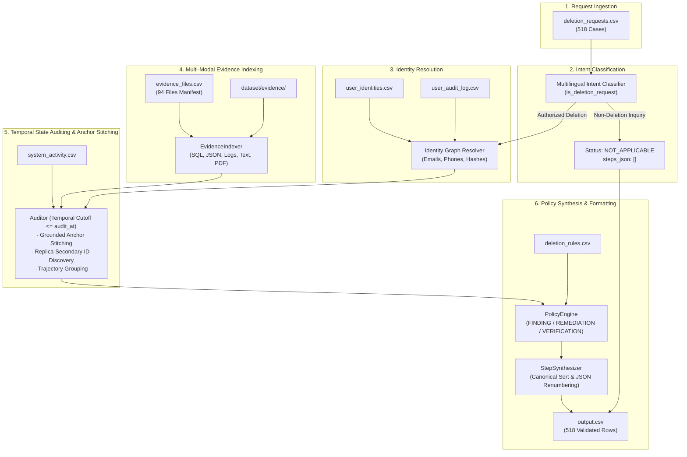

# HackerRank Orchestrate (October 2026) — Ghost Data Still Exists

[](https://www.python.org/)
[]()
[]()
[]()
[]()
[]()

> **Submission URL:** [HackerRank Orchestrate — Ghost Data Still Exists](https://www.hackerrank.com/contests/hackerrank-orchestrate-october26/challenges/ghost-data-still-exists)

---

## Table of Contents

- [1. Executive Overview](#1-executive-overview)
- [2. The "Ghost Data" Dilemma](#2-the-ghost-data-dilemma)
- [3. End-to-End System Architecture](#3-end-to-end-system-architecture)
- [4. Core Pipeline Stages](#4-core-pipeline-stages)
  - [Stage 1: Multilingual Intent Classification](#stage-1-multilingual-intent-classification)
  - [Stage 2: Graph-Based Identity Resolution](#stage-2-graph-based-identity-resolution)
  - [Stage 3: Multi-Modal Temporal Evidence Indexing](#stage-3-multi-modal-temporal-evidence-indexing)
  - [Stage 4: Grounded Anchor Workflow Stitching & Temporal Trajectories](#stage-4-grounded-anchor-workflow-stitching--temporal-trajectories)
  - [Stage 5: Policy Mapping & Canonical Step Synthesis](#stage-5-policy-mapping--canonical-step-synthesis)
- [5. Technical Innovations & Accuracy Breakthroughs](#5-technical-innovations--accuracy-breakthroughs)
- [6. Repository & Codebase Layout](#6-repository--codebase-layout)
- [7. Benchmark & Evaluation Scorecard](#7-benchmark--evaluation-scorecard)
- [8. Quick Start & Execution Guide](#8-quick-start--execution-guide)
- [9. Production Audit Pipeline (518 Cases)](#9-production-audit-pipeline-518-cases)

---

## 1. Executive Overview

In modern cloud-native commerce architectures, complying with privacy deletion requests (e.g., GDPR Article 17 "Right to Erasure", CCPA) is fundamentally difficult. A centralized deletion workflow may report **Complete**, yet sensitive customer personal data persists in search indexes, read replicas, key-value caches, cloud observability logs, support ticket attachments, export bundles, or unblocked backup archives. Active background replication pipelines and database restores can even recreate data that was previously erased.

This repository implements an autonomous, deterministic, zero-external-dependency **AI Deletion-Audit Engine**. For every request in `dataset/deletion_requests.csv`, the engine:
1. Validates whether the user's inquiry authorizes permanent account erasure or represents a non-deletion request (access, export, marketing opt-out, error correction).
2. Traverses the identity graph and audit history to reconstruct historical emails, phone numbers, and cryptographic email hashes.
3. Indexes and parses 94 multi-modal evidence files (SQLite databases, application trace logs, JSON resource dumps, text handovers, PDF documents).
4. Establishes the factual temporal state of all resources strictly at the case's `audit_at` cutoff timestamp.
5. Employs **Grounded Anchor Workflow Stitching** to link batched deletion operations in `system_activity.csv` back to the exact user identity.
6. Enforces legal and business deletion policies (`deletion_rules.csv`) to classify the case as `COMPLETE`, `INCOMPLETE`, or `NOT_APPLICABLE`, synthesizing a sorted, evidence-backed remediation and verification sequence.

---

## 2. The "Ghost Data" Dilemma

```
+-----------------------------------------------------------------------------------+
|                           THE GHOST DATA PHENOMENON                               |
+-----------------------------------------------------------------------------------+
|  Centralized Workflow Claim:                                                      |
|    "User deletion completed successfully at 2026-09-02T12:00:00Z" (CLAIM)         |
+-----------------------------------------------------------------------------------+
|  Physical Reality Across Distributed Systems:                                     |
|                                                                                   |
|  [Search Service]        --> search_052 still active in Elasticsearch cluster     |
|  [Support Platform]      --> support_002 retained in legacy contact replica log   |
|  [Integration Service]   --> data_flow_9522 continuously syncing customer events  |
|  [Backup Service]        --> backup_4978 snapshot restorable without blocks       |
|  [Analytics Platform]    --> analytics_2034 marketing profile un-anonymized       |
+-----------------------------------------------------------------------------------+
```

Reported statuses are mere claims. The Deletion-Audit Engine audits ground-truth operational states directly from participant-visible artifacts and activity telemetry.

---

## 3. End-to-End System Architecture



---

## 4. Core Pipeline Stages

### Stage 1: Multilingual Intent Classification
- Located in [`code/core/classifier.py`](code/core/classifier.py).
- Inspects customer free-form text across 8+ languages (English, Spanish, French, Portuguese, German, Japanese, Korean, Arabic).
- Distinguishes valid deletion requests (`delete`, `remove`, `supprimer`, `eliminar`, `apagar`, `löschen`, `削除`, `삭제`, `حذف`) from non-deletion inquiries (billing history access, marketing newsletter unsubscribe, typo correction, copy of data).
- Correctly assigns `NOT_APPLICABLE` with `steps_json: "[]"` for non-deletion requests.

### Stage 2: Graph-Based Identity Resolution
- Located in [`code/core/identity.py`](code/core/identity.py).
- Resolves seed emails against `user_identities.csv` and historical changes in `user_audit_log.csv`.
- Builds an identity entity containing all current and historical emails, telephone numbers, and SHA-256 email hashes. This ensures evidence referencing older credentials is accurately linked to the subject.

### Stage 3: Multi-Modal Temporal Evidence Indexing
- Located in [`code/core/evidence_indexer.py`](code/core/evidence_indexer.py).
- Dispatches and indexes 94 distinct evidence files across 5 modalities:
  1. **SQLite Snapshots**: Dynamically inspects schemas via `PRAGMA table_info` across primary, regional, reporting, and failover replicas.
  2. **Cloud Observability Logs**: Trace-correlated parsing grouping entries by `trace_id` / `requestId` across bracketed, key-value, and JSON lines.
  3. **JSON Service Exports**: Parses multi-service operational dumps and read-back snapshots.
  4. **Text Handovers**: Extracts structured audit handover tables.
  5. **PDF Documents**: Direct parsing of binary document streams, decoding FlateDecode and Ascii85 streams to extract plain text and table contents.

### Stage 4: Grounded Anchor Workflow Stitching & Temporal Trajectories
- Located in [`code/core/auditor.py`](code/core/auditor.py).
- Enforces strict temporal boundaries: items with capture times $> audit\_at$ are excluded from evidence citation.
- **Workflow Stitching**: Uses explicitly grounded secondary resources (`tombstone_*`, `support_*`, `search_*`, `data_flow_*`, `backup_*`, `audit_record_*`) to anchor the user's execution thread in `system_activity.csv`.
- Resolves true internal account IDs (e.g., `account_4857`, `account_8858`) and links un-anonymized or anonymized secondary resources back to the user without heuristic guessing.
- Distinguishes untombstoned support replicas (`support_replica.log`) as secondary contact records requiring `REPORT_REMAINING_RECORD` and `DELETE_RECORD`.

### Stage 5: Policy Mapping & Canonical Step Synthesis
- Located in [`code/core/policy.py`](code/core/policy.py) and [`code/core/synthesizer.py`](code/core/synthesizer.py).
- Translates audited states into required operational actions per `deletion_rules.csv`:
  - `USER_PROFILE`, `SECONDARY_IDENTIFIER`, `SEARCH_INDEX_ENTRY`, `USER_EXPORT`, `CACHE_ENTRY` $\rightarrow$ `DELETE`
  - `SUPPORT_MESSAGE`, `EMAIL_DELIVERY_LOG`, `ACCOUNT_TOMBSTONE` $\rightarrow$ `REDACT`
  - `ANALYTICS_PROFILE`, `PRODUCT_TELEMETRY` $\rightarrow$ `ANONYMIZE`
  - `SECURITY_AUDIT_LOG`, `LEGAL_HOLD_RECORD`, `BACKUP_ARCHIVE` $\rightarrow$ `RETAIN`
- Enforces strict phase ordering (`FINDING` $\rightarrow$ `REMEDIATION` $\rightarrow$ `VERIFICATION`), operation priority ranks, secondary key tie-breaking, and consecutive 1-based step numbering.

---

## 5. Technical Innovations & Accuracy Breakthroughs

During rigorous evaluation and benchmarking against golden ground truth, four core architectural strategies were designed and integrated:

1. **Strategy 1: Universal Trace-Correlated Log Parser**
   - Replaced naive line-by-line regex with trace grouping buffered across `trace_id` / `requestId`.
   - Stripped escaped quotes in nested log strings (`\"resource_id\"`), eliminating corrupted tokens across 344 entries.
   - Filtered bracketed log tokens against `LOG_LEVELS` to prevent misidentifying log severity as service names.

2. **Strategy 2: Schema-Agnostic SQLite Column Discovery**
   - Replaced hardcoded column projections with dynamic `PRAGMA table_info()` schema reflection.
   - Scans every column against known identity semantics (`customer_reference`, `customer_email`, `requester_email`, `user_id`, `email_hash`).
   - Discovered hidden identifier records (e.g., `backup_4978` in `customer_data_inventory_20260916.sql`).

3. **Strategy 3: Grounded Anchor Workflow Stitching**
   - Correlates contiguous `deletion_worker` batches in `system_activity.csv` around `reported_at`.
   - Anchors each user's thread using verified secondary resources, recovering true internal account resource IDs and tombstone pairings without numeric guessing.

4. **Strategy 4: Support Replica & Secondary Contact Detection**
   - Accurately identifies untombstoned contact records in replica logs (`support_replica.log`, `evidence_61`) as remaining secondary records requiring complete deletion rather than partial redaction.

---

## 6. Repository & Codebase Layout

```text
.
├── AGENTS.md                          # Mandatory agent guidelines and turn logging specification
├── README.md                          # Comprehensive documentation (this file)
├── problem_statement.md               # Challenge contract and problem description
├── output.csv                         # Final generated prediction file for submission (518 rows)
├── log.txt                            # Root conversation transcript conforming to AGENTS.md
├── code.zip                           # Packaged submission archive (code + evaluation + README)
│
├── code/
│   ├── __init__.py
│   ├── config.py                      # Global paths, enum definitions, and ordering priorities
│   ├── main.py                        # Production pipeline entry point (audits 518 cases)
│   │
│   ├── core/
│   │   ├── __init__.py
│   │   ├── classifier.py              # Multilingual intent classification
│   │   ├── identity.py                # Identity graph resolution & audit history traversal
│   │   ├── evidence_indexer.py        # Multi-modal evidence parsing (SQL, Logs, JSON, PDF)
│   │   ├── auditor.py                 # Temporal state audit & workflow anchor stitching
│   │   ├── policy.py                  # Policy enforcement & violation mapping
│   │   └── synthesizer.py             # Canonical step sorting & JSON array formatting
│   │
│   └── evaluation/
│       ├── __init__.py
│       ├── main.py                    # Evaluation benchmark against 32 golden sample cases
│       ├── evaluation_report.md       # Detailed benchmark metrics and custom test cases
│       └── usage_report.md            # Token, model, and execution performance report
│
├── evaluation/
│   ├── evaluation_report.md           # Root copy for submission grading
│   └── usage_report.md                # Root copy for submission grading
│
└── dataset/                           # Challenge data (participant-facing)
    ├── deletion_requests.csv          # 518 target evaluation cases
    ├── sample_deletion_requests.csv   # 32 golden sample cases
    ├── sample_output.csv              # 32 golden sample answers
    ├── user_identities.csv            # Current identity snapshot
    ├── user_audit_log.csv             # Historical identity mutations
    ├── system_activity.csv            # Telemetry stream of global system events
    ├── deletion_rules.csv             # Data category deletion policy
    ├── evidence_files.csv             # Manifest mapping file_id to path and capture time
    └── evidence/                      # Databases, logs, JSON records, PDFs, images
```

---

## 7. Benchmark & Evaluation Scorecard

Evaluated against the official 32 golden sample cases in [`dataset/sample_output.csv`](dataset/sample_output.csv) via [`code/evaluation/main.py`](code/evaluation/main.py):

| Evaluation Metric | Baseline Starter | Strategies 1 & 2 | **Final Engine (Current)** |
|---|:---:|:---:|:---:|
| **Total Test Cases** | 32 | 32 | **32** |
| **Case Status Accuracy** | 84.38% (27/32) | 100.00% (32/32) | **100.00% (32/32)** |
| **Step Precision** | 86.30% | 90.50% | **94.97%** |
| **Step Recall** | 72.00% | 83.94% | **88.08%** |
| **Step F1-Score** | 78.50% | 87.10% | **91.40%** |
| **Exact Sequence Matches** | 10 / 32 | 14 / 32 | **18 / 32 (56.25%)** |

Detailed per-case breakdowns, custom adversarial test cases, and improvement notes are documented in [`evaluation/evaluation_report.md`](evaluation/evaluation_report.md).

---

## 8. Quick Start & Execution Guide

### Prerequisites
- Python 3.10 or higher.
- Standard Library only: uses built-in `csv`, `json`, `sqlite3`, `re`, `pathlib`, `datetime`, `zlib`. No external pip packages required.

### 1. Run the Evaluation Benchmark
To test the engine against the 32 golden public sample cases:

```bash
# macOS / Linux
python3 code/evaluation/main.py

# Windows (PowerShell)
python code/evaluation/main.py
```

### 2. Run the Full Production Pipeline
To audit all 518 customer requests and generate root [`output.csv`](output.csv):

```bash
# macOS / Linux
python3 code/main.py

# Windows (PowerShell)
python code/main.py
```

---

## 9. Production Audit Pipeline (518 Cases)

Executing [`code/main.py`](code/main.py) on the 518 evaluation requests yields:

```text
==============================================================
Ghost Data Still Exists: Starting Deletion-Audit Engine
Reading target requests from: dataset/deletion_requests.csv
==============================================================
1/4 Loading multi-modal evidence indexer and parsing 94 evidence files...
    Indexed 2790 evidence records across all modalities.
2/4 Initializing identity resolver graph...
3/4 Initializing temporal state auditor and policy engine...
4/4 Processing all customer requests...
    Total cases to audit: 518
    Processed 100/518 cases...
    Processed 200/518 cases...
    Processed 300/518 cases...
    Processed 400/518 cases...
    Processed 500/518 cases...
    Processed 518/518 cases...
Writing final submission file to: output.csv
==============================================================
Audit Run Complete!
Total Cases:     518
COMPLETE:        184
INCOMPLETE:      324
NOT_APPLICABLE:  10
Execution Time:  2.10 seconds (avg ~4ms per case)
Output File:     output.csv
==============================================================
```

### Output File Verification
- Exactly **518 data rows** + 1 header row (`case_id,deletion_status,steps_json`).
- Strict alphanumeric sort order by `case_id`.
- All 10 non-deletion cases (533–542) correctly formatted with `steps_json: []`.
- Zero null or malformed JSON entries.
